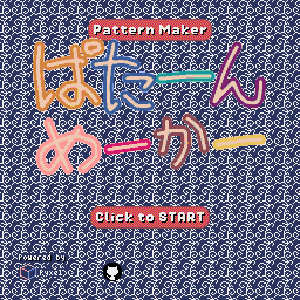
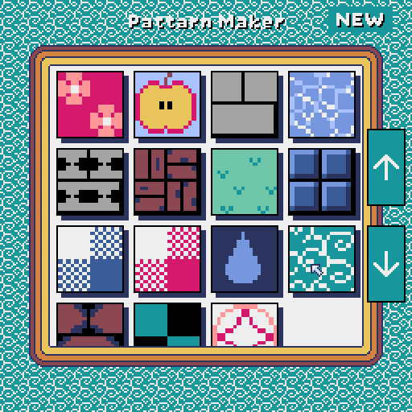
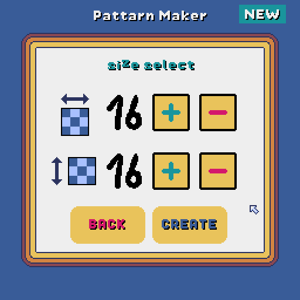
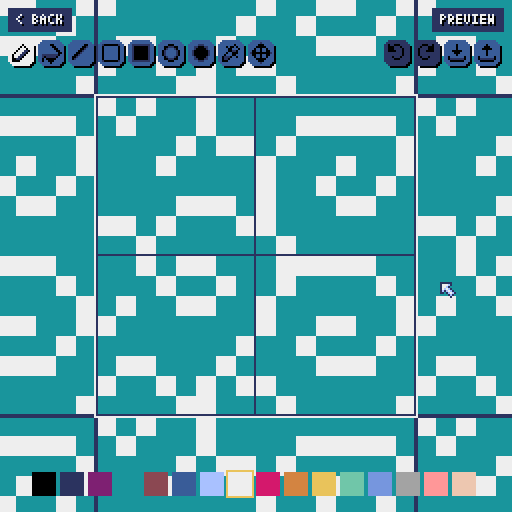

# PATTERN MAKER
  
Pyxel専用のパターン作成ツールです。画像として保存することができます。

最小8×8、最大48×48までの任意のサイズに対応しています。

## OPEN 開く
[PATTERN MAKER](https://okapping.github.io/pattern-maker/)

## HOW TO USE　つかいかた
|キー|使い方|
|-|-|
|[←]|色の変更|
|[→]|色の変更|
|[option]+[←]|ツールの変更|
|[option]+[→]|ツールの変更|
|[↑]|表示サイズ 拡大|
|[↓]|表示サイズ 拡小|
|[P]|プレビューモード（実際のサイズで画面全体に並べて表示します。）|
|[S]|作成した画像の保存|
|[C]|クリア（全体を黒に戻す）|
|[Q]|表示サイズ変更：小（64px）|
|[W]|表示サイズ変更：中（96px）|
|[E]|表示サイズ変更：大（128px）|
|[R]|表示サイズ変更：特大（160px）|

## SCREEN SHOT スクリーンショット

## SAMPLES 作成サンプル

## 更新履歴
| 日付 | 更新内容 |
| --- | --- |
| 2026/10/5 | 初版作成 |
| 2026/11/14 | 16*16以外のサイズも対応 |
